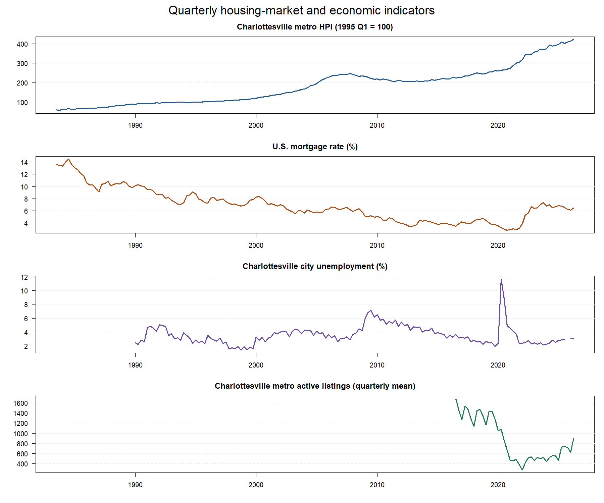
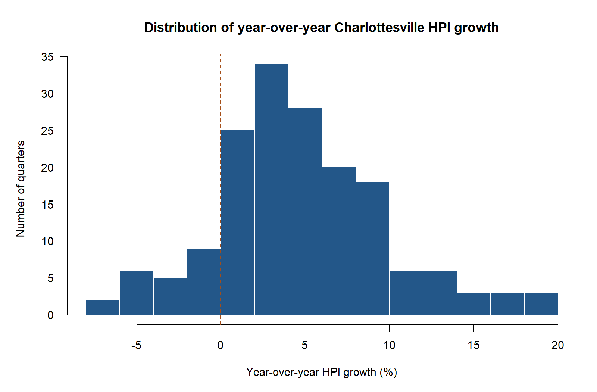

# Data documentation

## Data summary

`Raw_Combined_ FRED_Data.csv` contains four independent date/value pairs in 2,898
rows. Values on the same raw row do not necessarily describe the same date.
`cleaned_quarterly.csv` is the main cleaned dataset: 172 calendar quarters from
1983 Q3 through 2026 Q2, with four levels and four year-over-year changes.
Some columns are blank before their source begins or where data are unavailable.

Three smaller files select HPI and one predictor, with both their levels and
annual changes: `hpi_vs_mortgage.csv` (172 quarters), `hpi_vs_unemployment.csv`
(146 quarters), and `hpi_vs_listings.csv` (40 quarters). Each includes `quarter`
and `quarter_start`. They begin when HPI and that predictor first overlap;
missing quarters inside the overlap stay in place, including 2025 Q4 unemployment.
Use the existing annual-change columns, create lags before dropping missing rows,
and use the same date window when comparing strengths across predictors.

## Cleaning

`SCRIPTS/01_preprocess_data.py` reads each series using its own dates, validates
numbers/dates and duplicate keys, then joins by calendar quarter. HPI stays as
observed. Mortgage rates are averaged across weekly observations in the quarter;
unemployment and listings are averaged across the three months. Listings measure
average inventory, not a quarterly sales total. Quarterly mortgage means are taken
directly from weekly data, not from equally weighted monthly means.

All three monthly values are required. October 2025 unemployment is missing, so
2025 Q4 unemployment stays blank. No missing values are filled, and COVID-era
extremes are retained. Weekly coverage requires all values present, at least 12
observations, and observations within nine days of both quarter boundaries;
source gaps over nine days are rejected. This allows holiday release shifts but
is a coverage screen rather than an official release-calendar audit.

Annual changes are calculated on the full calendar before filtering dates or
removing rows. For HPI/listings, change is `100 * (value / value_four_quarters_ago - 1)`.
For rates, it is `value - value_four_quarters_ago`, in percentage points. A rate
change from 6% to 7% is one percentage point. A zero prior listing count makes its
percentage change unavailable. The script preserves the original file.

## Provenance

HPI is FHFA's Charlottesville MSA index [1]; mortgage rates are Freddie Mac's U.S.
30-year fixed rate [2]; listings are Realtor.com's Charlottesville CBSA inventory
[4]. Sampled unemployment values match BLS's Charlottesville city series
VACHAR0URN [3]. The MI2 provenance named CHAR851URN, which is instead the MSA
series. City identity is inferred from matching observations because the CSV
contains no series ID. Supplied values have not been replaced. The four series
are not seasonally adjusted; values can be revised.

## License

Code uses the repository's MIT license. Source data retain their providers' terms:
FHFA/BLS are government sources; Freddie Mac and Realtor.com identify copyrighted
data. Cite the sources below and check their reuse terms [1]-[5].

## Ethical statements

These are aggregate public data with no individual people or properties identified.
Report associations without claiming causation. State that unemployment covers the
city, HPI/listings cover the metro area, and mortgage rates are national. Those
geographies do not capture every local neighborhood or household.

## Data dictionary

The original columns come in these date/value pairs:

| Raw date column | Raw value column | Frequency and unit |
| --- | --- | --- |
| `observation_date_ATHPI` | `all_transactions HPI` | Quarterly HPI, index points |
| `observation_date_mortgage` | `mortgage` | Weekly mortgage rate, percent |
| `observation_date_unemployment` | `Unemployment_rate` | Monthly city unemployment, percent |
| `observation_date_listing count` | `HPI_Listing Count` | Monthly active inventory, listings; not an HPI |

Each cleaned row is one quarter. Blank numeric cells mean missing, not zero.

| Cleaned column | Meaning |
| --- | --- |
| `quarter` | Calendar quarter, such as 2025Q2 |
| `quarter_start` | ISO first date of that quarter |
| `hpi` | Observed metro HPI; 1995 Q1 = 100; not dollars |
| `mortgage_rate_pct` | Mean weekly national mortgage rate (%) |
| `unemployment_rate_pct` | Mean monthly city unemployment rate (%) |
| `active_listings` | Mean monthly metro inventory; may be fractional |
| `hpi_yoy_pct` | HPI percentage growth over four quarters; planned outcome |
| `mortgage_rate_yoy_pp` | Mortgage rate change over four quarters, percentage points |
| `unemployment_rate_yoy_pp` | Unemployment change over four quarters, percentage points |
| `active_listings_yoy_pct` | Listing percentage change over four quarters |

## What partners do next

A **lag** compares an earlier predictor with the outcome quarter. For example,
lag 1 pairs the predictor's 2025 Q1 annual change with 2025 Q2 HPI growth. Lag 0
uses the same quarter; lag 4 uses one year earlier. This delay is separate from
calculating the annual change itself.

The MI2 plan first compares each predictor individually at lags 0-4, then fits
selected predictors **together** in multiple regression. A coefficient tests
whether that predictor is associated with HPI growth after accounting for the
others. Lag comparisons/selection are exploratory; time-series tests should not
assume all quarters are independent.

Haero: use this CSV for both MI2 windows (1990-2025: mortgage/unemployment;
2016 Q3-2025: add listings). Create lags on the continuous calendar first, then
filter the window and drop missing rows for the chosen variables. Choose/report
lags, standardize on the actual model sample, fit the models, and use Newey-West
standard errors with maximum lag 4 as planned [6]. The CSV retains 2026 data for
transparency; exclude it from the planned 2025 study windows. Usable samples
start later than the raw windows because annual changes need four prior quarters
(unemployment changes begin 1991 Q1; listing changes begin 2017 Q3), and lags
require more history. Compare models with/without listings on the same recent
sample when assessing listings' additional contribution.

Hershi: report sample sizes, coefficients, confidence intervals, p-values, R-squared,
adjusted R-squared, VIF, and residual diagnostics. Save analysis figures/tables in
OUTPUT and add reproducible analysis scripts and references. The cleaning and
exploratory plots are ready; the models and statistical results remain unfinished.

## Explanatory plots

The MI2 assigns exploratory plots/statistical analysis to Hershi and preprocessing
to Andrew. These descriptive figures provide the two plots required by MI3's data
documentation and can serve as starting material for Hershi to review or revise.
They do not replace Haero's models or Hershi's statistical tests and result figures.

Figure 1. Separate panels keep each series in its original units and show its
actual coverage. HPI trends upward, listings start in 2016, and unemployment has
a large 2020 spike. These patterns alone do not rank predictors.

Figure 2. Distribution of quarterly year-over-year HPI growth, the planned
regression outcome. The dashed line marks zero growth. This describes the outcome
without establishing any predictor's association.

## References

[1] U.S. Federal Housing Finance Agency, "All-Transactions House Price Index for Charlottesville, VA (MSA)," FRED, series ATNHPIUS16820Q. [Online]. Available: https://fred.stlouisfed.org/series/ATNHPIUS16820Q. [Accessed: Oct. 19, 2026].

[2] Freddie Mac, "30-Year Fixed Rate Mortgage Average in the United States," FRED, series MORTGAGE30US. [Online]. Available: https://fred.stlouisfed.org/series/MORTGAGE30US. [Accessed: Oct. 19, 2026].

[3] U.S. Bureau of Labor Statistics, "Unemployment Rate in Charlottesville City, VA," FRED, series VACHAR0URN. [Online]. Available: https://fred.stlouisfed.org/series/VACHAR0URN. [Accessed: Oct. 19, 2026].

[4] Realtor.com, "Housing Inventory: Active Listing Count in Charlottesville, VA (CBSA)," FRED, series ACTLISCOU16820. [Online]. Available: https://fred.stlouisfed.org/series/ACTLISCOU16820. [Accessed: Oct. 19, 2026].

[5] Federal Reserve Bank of St. Louis, "Legal Notices, Information and Disclaimers," FRED. [Online]. Available: https://fred.stlouisfed.org/legal/. [Accessed: Oct. 16, 2026, in the original MI2 documentation].

[6] W. K. Newey and K. D. West, "A simple, positive semi-definite, heteroskedasticity and autocorrelation consistent covariance matrix," Econometrica, vol. 55, no. 3, pp. 703-708, May 1987, doi: 10.2307/1913610.
